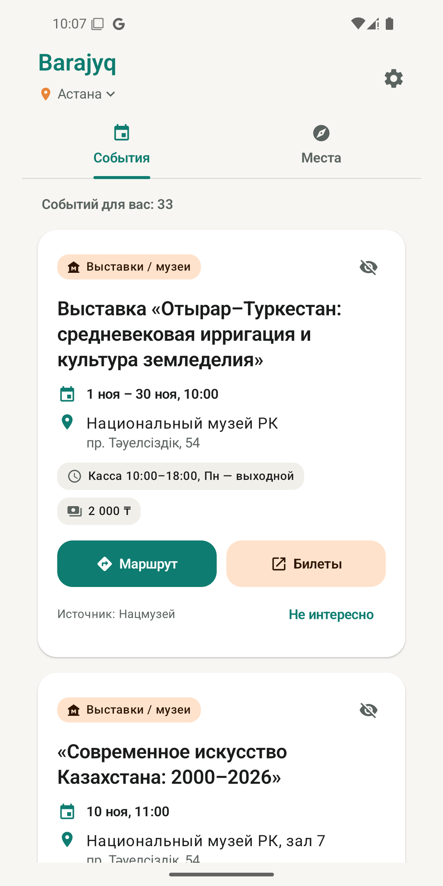
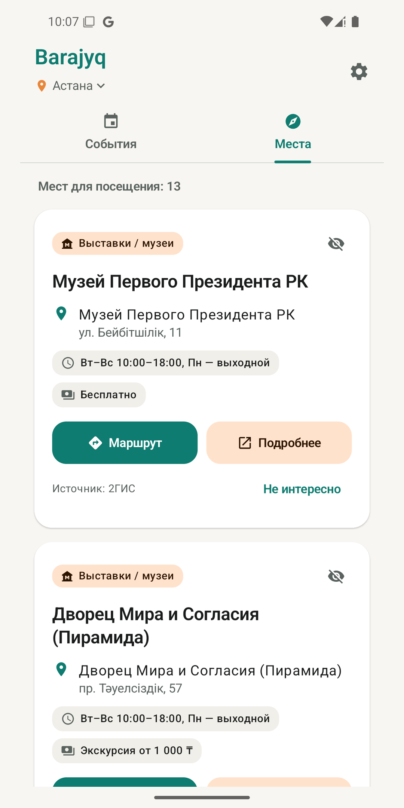
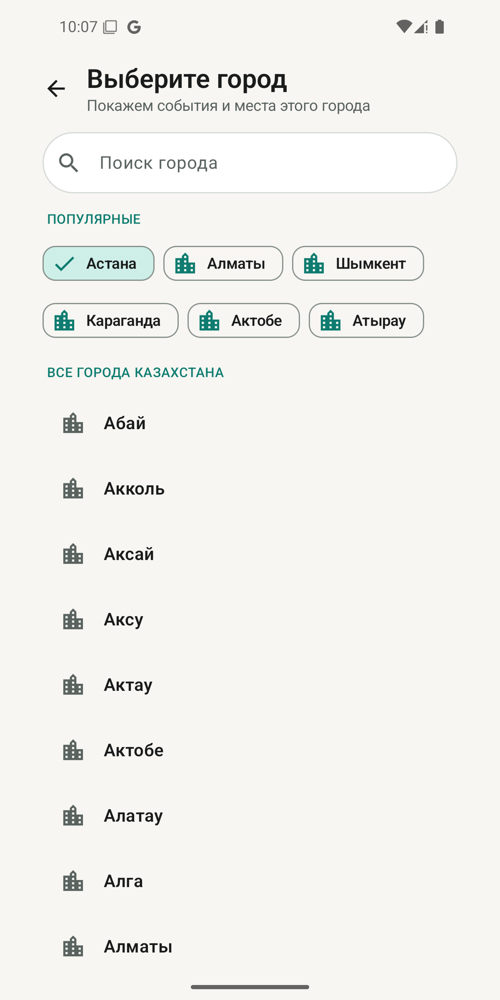
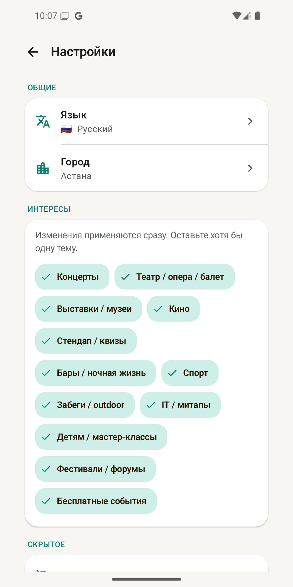

# Barajyq — events guide for Kazakhstan

Barajyq (*«Барайық»*, Kazakh for "let's go") is a mobile events guide for Kazakhstan: concerts, theatre,
exhibitions, stand-up, kids' events, tours and places to visit in **20 cities**, in **Kazakh, Russian and
English**. The feed currently holds ~1,900 upcoming events and is refreshed every other day by an automated
monitoring pipeline.

  
  
  
  

Built single-handedly (product, design, code, content pipeline, store release) with AI-assisted development.
Status: closed testing on Google Play.

## Features
- Interest-based onboarding (12 topics), city choice from all 96 cities of Kazakhstan, guest mode.
- Events feed grouped by day (today, tomorrow, this week, ongoing runs), search, filters by category, price
  and date, sorting, saved events, "not interested" with undo.
- Event details with full description, price, source link and a one-tap route in 2GIS.
- Ended events disappear automatically on the device (UTC+5, an event is hidden only after its last day ends).
- **Remote feed**: apps download `events.json` from GitHub Pages
  ([hexusArgon/barajyq-feed](https://github.com/hexusArgon/barajyq-feed)), so new events reach every installed
  app without a store release; the bundled copy is the offline fallback.

## Content pipeline (`tools/`)
Python tools turn public announcements into one validated JSON feed:
- **Telegram**: 38 public channels (`tg_to_feed.py`, `browser_scan.py`).
- **Instagram**: 72 venue and organiser accounts (`ig_sources.json`, `ig_merge_scan.py`).
- **Websites**: Ticketon, Sxodim and Kino.kz via schema.org Event data and the Kino.kz API (`web_scan.py`).
- Dates are parsed into machine-readable schedules (`schedule.py`); a content policy (`event_policy.py`)
  rejects roundups, online events and posts without a clear date and venue; duplicates across sources are
  merged. Nothing is guessed: a missing fact stays empty.
- `build_feed_site.py` publishes a minified feed (ended events removed) for the apps.
- Runbook of the scheduled monitoring run: [`tools/MONITORING.md`](tools/MONITORING.md); tests in `tools/tests/`.

## Tech
| Part | Stack |
|---|---|
| Android (`android/`) | Kotlin, Jetpack Compose, Material 3, coroutines, DataStore, Coil, Credential Manager; min SDK 26, target 36 |
| iOS (`ios/`) | SwiftUI, iOS 16+ (port of the Android app; needs a Mac with Xcode to build) |
| Data | JSON feed `feed/events.json`, GitHub Pages hosting |
| Tooling | Python 3 importers and generators with unit tests |

## Build
Android: JDK 17 and Android SDK 36, then from `android/`: `gradlew assembleDebug`.
Release signing is local only (`android/keystore.properties.example`, `play-store/SIGNING.md`); keys are not in
the repository. iOS: open `ios/Barajyq.xcodeproj` in Xcode 15+ (see `ios/README.md`).

Tools: `python3 -m unittest discover -s tools/tests`.

## Privacy
No account is required and no personal data is collected:
[privacy policy](https://hexusargon.github.io/barajyq-privacy/).
